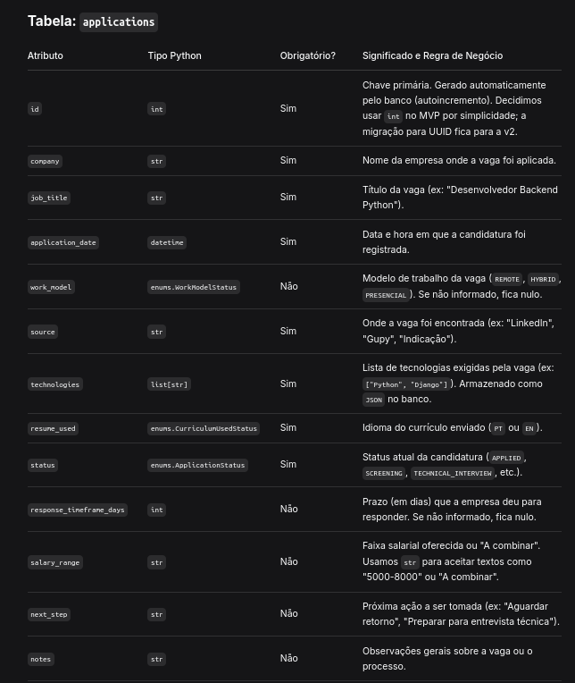

# Schema do MVP — JobTracker API

## Tabela: `candidaturas`

| Campo | Tipo     | Obrigatório | Notas           |
|-------|----------|-------------|-----------------|
| id    | int (PK) |     sim     | auto-incremento |
| empresa | str | sim | |
| cargo | str | sim | |
| data_aplicacao | date | sim | renomeado de "Data" |
| modelo_trabalho | Enum | sim | REMOTO, HIBRIDO, PRESENCIAL |
| fonte | str | sim | LinkedIn, Gupy, etc. |
| tecnologias | JSON (list[str]) | sim | ex.: ["Python", "Django"] |
| curriculo_utilizado | Enum | sim | PT, EN |
| status | Enum | sim | APLICADO, TRIAGEM, ENTREVISTA_TECNICA, ENTREVISTA_RH, OFERTA, REJEITADO, DESISTIU |
| prazo_resposta_dias | int | não | nullable |
| faixa_salarial | int | não | nullable ("a combinar") |
| proxima_acao | str | não | follow-up |
| observacoes | str | não | |

## Tabela: `entrevistas`

| Campo | Tipo | Obrigatório | Notas |
|---|---|---|---|
| id | int (PK) | sim | |
| candidatura_id | int (FK) | sim | → candidaturas.id |
| data_entrevista | date | sim | |
| etapa | Enum | sim | RH, TECNICA, CULTURAL, FINAL |
| idioma | Enum | sim | PT, EN |
| resultado | Enum | sim | APROVADO, REPROVADO, EM_ANDAMENTO, CANCELADO |
| feedback | str | não | |
| proximos_passos | str | não | |

## Decisões de escopo (v2+)
- `compatibilidade` e `lacunas_identificadas`: cortados do MVP (fluxo manual não usa)
- Busca automática de vagas (v2)
- Score de compatibilidade calculado (v2)
- IA (v3)
- Tabela `User` + auth JWT (Fase 4)

## Tabela: applications

